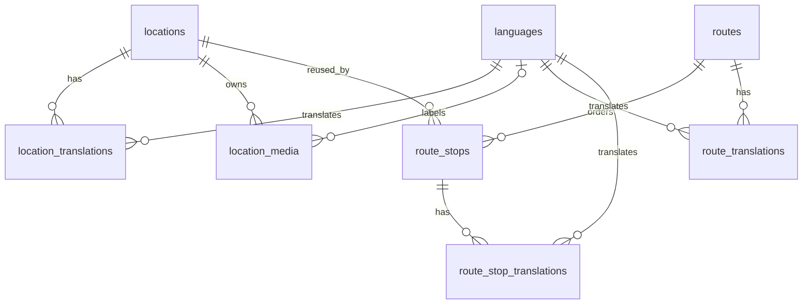

# Phase 1 architecture

One public PHP shell loads route-specific JSON. PHP/PDO reads the normalized database; vanilla ES modules own visitor state and behavior. Admin forms are server-rendered, authenticated, and CSRF protected. All content is plain text, escaped on the server or inserted with `textContent`; staff cannot inject HTML.

## Relationships

`users` stores admin password hashes. `login_attempts` stores hashed account identifiers and short throttle windows. No visitor table or GPS history exists. The browser sends only route/language content requests, never coordinates. OSM requests necessarily identify tile areas and IP addresses to the map provider; the About page discloses this.

Foreign keys protect referenced places; route deletion cascades only through associations/translations. `(route_id,location_id)` and `(route_id,stop_order)` are unique. Admin saves reorder in a transaction, temporarily using negative unique order values and retaining stop IDs. Stable IDs preserve local progress. Route-specific instructions have their own extensible translation table.

## Modules

| Module | Responsibility |
| --- | --- |
| `app.js` | DOM orchestration, route loading, language switch, accessible arrival content |
| `gps.js` | Explicit permission/start, watchPosition, accuracy/freshness/jump rejection, simulation |
| `proximity.js` | Pure Haversine/debounce/hysteresis/priority engine |
| `tour.js` | Route-specific visited/triggered/current/start state |
| `storage.js` | Defensive localStorage access; no stored GPS coordinates |
| `map.js` | Leaflet map, schematic route, stop and position markers |
| `audio.js` | Shared MP3/TTS controller, voice choice and gesture/error fallback |
| `offline.js` | API access, complete content preparation and readiness metadata |
| `debug.js` | Explicit query-flag simulation controls and diagnostics |
| `i18n.js` | English/Italian interface labels, English fallback for other languages |
| `sw.js` | Public shell/content caches, offline navigation, audio byte ranges |

No GPS watch begins on page load. Resuming after refresh needs a gesture. Simulation is instantiated only for `?debug=1`, cancels a real watch, and uses a distinct session key. Manual browsing is independent of every GPS decision.

## Offline scope and updates

Shell and content have separate versioned caches. JSON is network-first with cached fallback on network failure; HTTP errors such as an unpublished route do not silently use stale data while online. Preparation records a manifest only after every requested file has succeeded. Browser eviction can still remove files, so readiness checks their presence. New app versions wait for older controlled tabs to close. No tile interception, background sync, location reporting, push service or audio provider is installed.

Offline audio range responses support native media seeking. Media filenames are random and immutable; replacement uploads get new paths. Staff must re-prepare updated content. An offline map provider may later be introduced behind `map.js` with explicitly permitted licensing/storage.

## Future assistant boundary

Add an authenticated/rate-limited server API for questions when Phase 2 is commissioned. It should resolve approved location knowledge by location ID, take route/language context, and keep provider credentials private. Verified sources can be a separate relation to locations. Existing narration controls can speak returned text later. No provider adapter, secret, API call, hidden placeholder chatbot, or unconstrained AI knowledge is included now.
